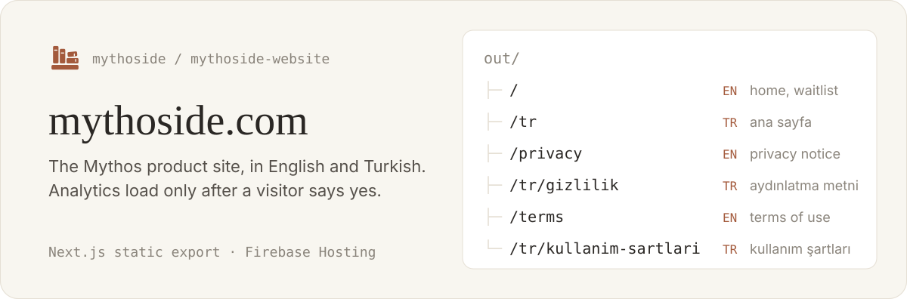
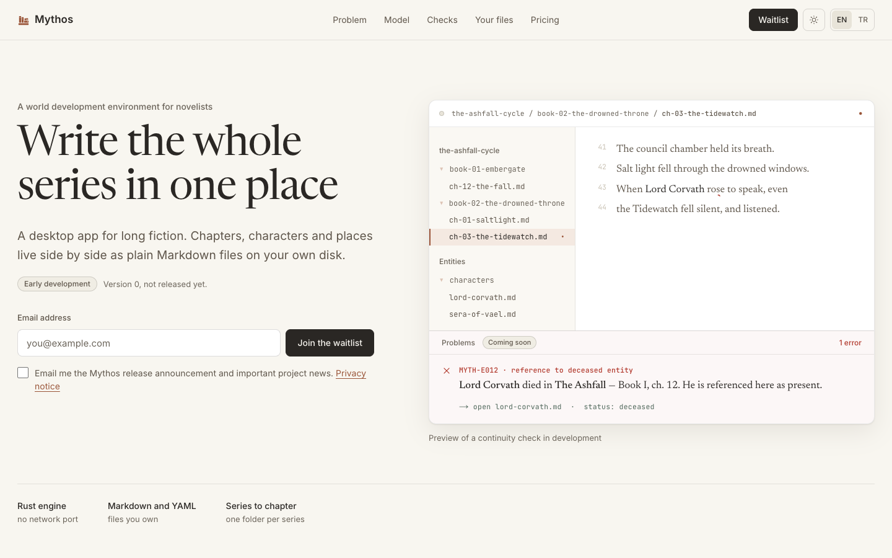

<p align="center">
  
</p>

<p align="center">
  <a href="https://mythoside.com">mythoside.com</a> · <a href="https://github.com/mythoside">Mythos</a> · <a href="./README.md">English</a> · Türkçe
</p>

<p align="center">
  <a href="https://mythoside.com"></a>
</p>

Seri yazmak için bir masaüstü uygulaması olan [Mythos](https://github.com/mythoside)'un ürün sitesi. Statik bir Next.js çıktısı: altı sayfa, İngilizce ve Türkçe, açık ve koyu tema. Firebase Hosting üzerinden yayınlanıyor. `main`'e yapılan her merge siteyi yayına alır.

## Sayfa ziyaretçiyle ne yapar

| Bölüm | Ne olur |
| --- | --- |
| **Bekleme listesi** | Form, yalnızca onay kutusu işaretlendikten sonra Cloud Firestore'a (AB, `eur3`) `waitlist/<email>` kaydını yazar. [`firestore.rules`](./firestore.rules) her adres için tek bir kayda izin verir; kayıtta tam olarak beş alan bulunur ve hepsi denetlenir: e-posta, dil, zaman, onay ve onay metninin sürümü. Bunun dışında hiçbir şeye izin verilmez: okuma, listeleme, güncelleme ve silme kapalıdır. |
| **Analitik** | Ziyaretçi çerez banner'ında analitiğe izin vermeden Google Tag Manager hiç istenmez. "Hayır" denirse ya da sonradan footer'daki "Çerez tercihleri"nden izin geri alınırsa kapalı kalır ve `_ga` çerezleri silinir. |
| **Çerezler** | O izin olmadan site hiç çerez yazmaz. Tema, dil ve çerez tercihi `localStorage`'da tutulur. |
| **Yasal sayfalar** | Aydınlatma metni ve kullanım şartları, iki dilde, [`src/content/`](./src/content) içinden üretilir. |

## Çalıştırma

```bash
git clone https://github.com/mythoside/mythoside-website.git
cd mythoside-website
npm install
npm run dev     # http://localhost:3000
npm run build   # out/ içine statik çıktı
npm run lint
```

Yerel sunucudaki form da canlı Firestore'a yazar, yani deneme kaydı gerçek bir kayıt oluşturur.

## Yayına alma

| Ne | Nasıl |
| --- | --- |
| Sayfalar | `main`'e merge et. GitHub Actions lint ve build'i çalıştırır, sonra `out/` klasörünü Firebase Hosting'e yükler. Pull request'ler için bir önizleme kanalı açılır. |
| Firestore kuralları | `npx firebase-tools deploy --only firestore:rules --project mythoside` |
| Hoş geldin maili | [`functions/`](./functions), yeni kayıtlara SMTP üzerinden mail gönderecek bir Cloud Function içerir. **Yayında değil.** Yayına alınmadan önce aydınlatma metninde mail sağlayıcısının adı yazmalı. |

## Teknoloji

| Katman | Araçlar |
| --- | --- |
| Arayüz | React 19, TypeScript, `any` yok |
| Çatı | Next.js App Router, `output: 'export'` |
| Stil | Tailwind CSS v4 ve `app/globals.css` içindeki tasarım değişkenleri |
| Yazı tipleri | Inter, Newsreader, JetBrains Mono; `next/font` ile siteden sunulur |
| Veri | REST API üzerinden Cloud Firestore; sayfada Firebase SDK yok |
| Barındırma | Firebase Hosting, GitHub Actions ile yayına alınır |

## Klasör yapısı

```text
app/(en)/, app/tr/        sayfalar: /, /privacy, /terms ve /tr, /tr/gizlilik, /tr/kullanim-sartlari
app/globals.css           tasarım değişkenleri, açık ve koyu tema
src/i18n/messages.ts      sayfadaki her metin, İngilizce ve Türkçe
src/content/              aydınlatma metni ve kullanım şartları, İngilizce ve Türkçe
src/components/sections/  ana sayfa: Navbar, Hero, Problem, HowItWorks, Features, Philosophy, OpenSource, FinalCTA, Footer
src/components/ui/        Logo, WaitlistForm, ConsentBanner, ReferenceGraph ve küçük parçalar
src/lib/                  bekleme listesi (Firestore), analitik (onay ve GTM), SEO, yazı tipleri, depolama anahtarları
src/enums.ts              bileşenleri besleyen kapalı seçenek kümeleri
firestore.rules           bekleme listesi kuralları
functions/                hoş geldin maili (yayında değil)
public/                   favicon, paylaşım görseli, logo dosyaları, robots.txt, sitemap.xml
```

Bir metni değiştirmek için `src/i18n/messages.ts` dosyasını düzenle; İngilizce ve Türkçe karşılıkları birlikte güncelle. Onay kutusunun ya da aydınlatma metninin söylediği şeyi değiştirirsen `src/lib/waitlist.ts` içindeki `CONSENT_VERSION` değerini artır.

## Lisans

Sitenin kodu MIT lisanslı, bkz. [LICENSE](./LICENSE). Mythos adı ve logosu bu lisansın kapsamında değil. Motor ve uygulama, kendi repolarında FSL-1.1-ALv2 lisansıyla yayımlanıyor.
