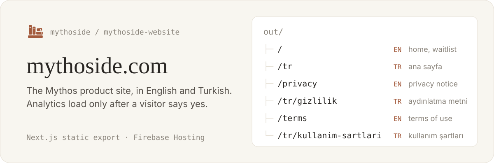
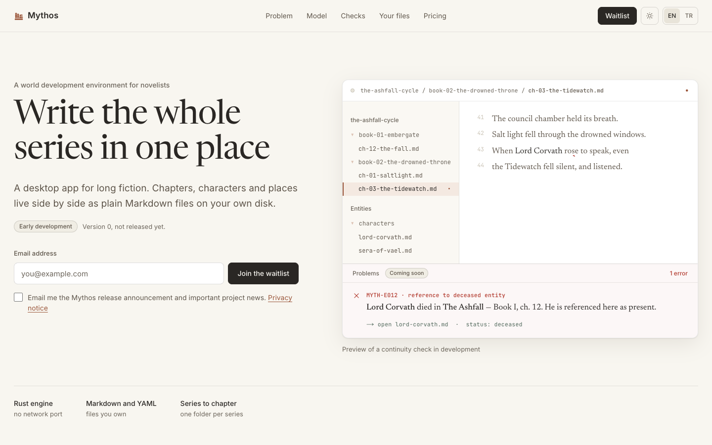

<p align="center">
  
</p>

<p align="center">
  <a href="https://mythoside.com">mythoside.com</a> · <a href="https://github.com/mythoside">Mythos</a> · English · <a href="./README.TR.md">Türkçe</a>
</p>

<p align="center">
  <a href="https://mythoside.com"></a>
</p>

The product site for [Mythos](https://github.com/mythoside), a desktop app for writing a series. It is a static Next.js export: six pages, English and Turkish, light and dark themes, served by Firebase Hosting. Every merge to `main` deploys it.

## What the page does with visitors

| Part | What happens |
| --- | --- |
| **Waitlist** | The form writes `waitlist/<email>` to Cloud Firestore (EU, `eur3`) only after the consent box is ticked. [`firestore.rules`](./firestore.rules) allow one create per address, with exactly five checked fields (email, language, time, consent, consent wording version), and nothing else: no read, list, update or delete. |
| **Analytics** | Google Tag Manager is not requested at all until the visitor allows analytics in the cookie banner. Saying no, or withdrawing later from "Cookie settings" in the footer, keeps it off and deletes the `_ga` cookies. |
| **Cookies** | Without that yes, the site sets none. Theme, language and the cookie choice live in `localStorage`. |
| **Legal pages** | Privacy notice and terms of use, in both languages, written from [`src/content/`](./src/content). |

## Run it

```bash
git clone https://github.com/mythoside/mythoside-website.git
cd mythoside-website
npm install
npm run dev     # http://localhost:3000
npm run build   # static export in out/
npm run lint
```

The form on a local server talks to the live Firestore, so a test signup creates a real entry.

## Deploy

| What | How |
| --- | --- |
| Pages | Merge to `main`. GitHub Actions runs lint and build, then deploys `out/` to Firebase Hosting. Pull requests get a preview channel. |
| Firestore rules | `npx firebase-tools deploy --only firestore:rules --project mythoside` |
| Welcome email | [`functions/`](./functions) holds a Cloud Function that would email new signups through SMTP. It is **not deployed**. Before it is, the privacy notice must name the mail provider. |

## Stack

| Layer | Tooling |
| --- | --- |
| UI | React 19, TypeScript, no `any` |
| Framework | Next.js App Router, `output: 'export'` |
| Styling | Tailwind CSS v4 plus the design tokens in `app/globals.css` |
| Fonts | Inter, Newsreader, JetBrains Mono, self-hosted by `next/font` |
| Data | Cloud Firestore over its REST API, no Firebase SDK in the page |
| Hosting | Firebase Hosting, deployed by GitHub Actions |

## Layout

```text
app/(en)/, app/tr/        routes: /, /privacy, /terms and /tr, /tr/gizlilik, /tr/kullanim-sartlari
app/globals.css           design tokens, light and dark themes
src/i18n/messages.ts      every line of page copy, English and Turkish
src/content/              privacy notice and terms of use, English and Turkish
src/components/sections/  the home page: Navbar, Hero, Problem, HowItWorks, Features, Philosophy, OpenSource, FinalCTA, Footer
src/components/ui/        Logo, WaitlistForm, ConsentBanner, ReferenceGraph and smaller parts
src/lib/                  waitlist (Firestore), analytics (consent and GTM), SEO, fonts, storage keys
src/enums.ts              closed option sets that feed the components
firestore.rules           waitlist rules
functions/                welcome email (not deployed)
public/                   favicon, share image, logo files, robots.txt, sitemap.xml
```

To change copy, edit `src/i18n/messages.ts` and keep English and Turkish in step. If you change what the consent checkbox or privacy notice says, bump `CONSENT_VERSION` in `src/lib/waitlist.ts`.

## License

The site's code is MIT, see [LICENSE](./LICENSE). The Mythos name and logo are not covered by it. The engine and the app are under FSL-1.1-ALv2 in their own repositories.
